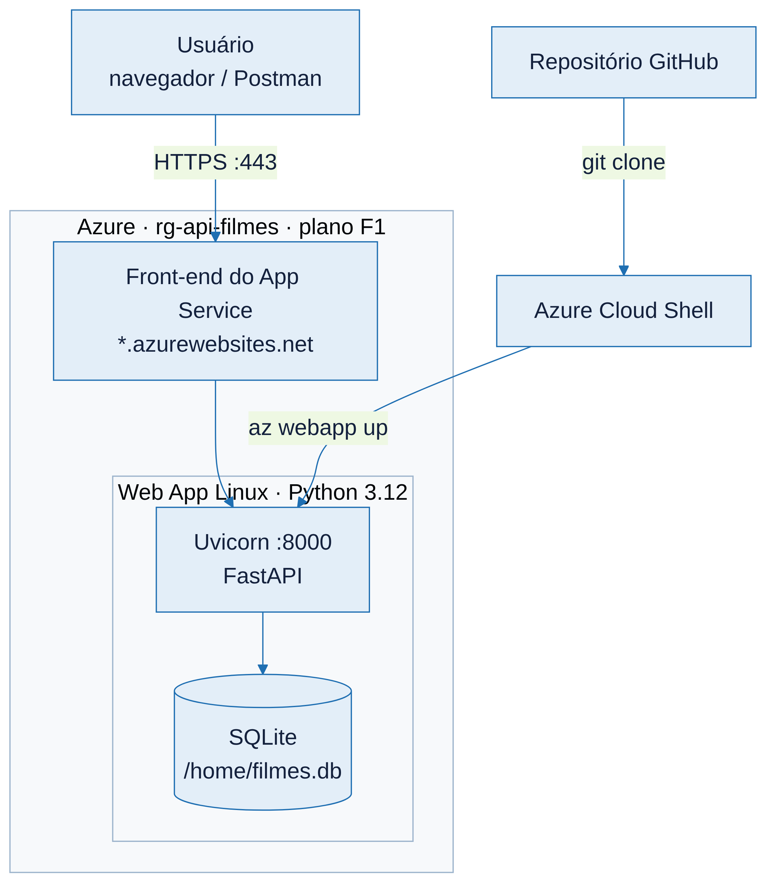
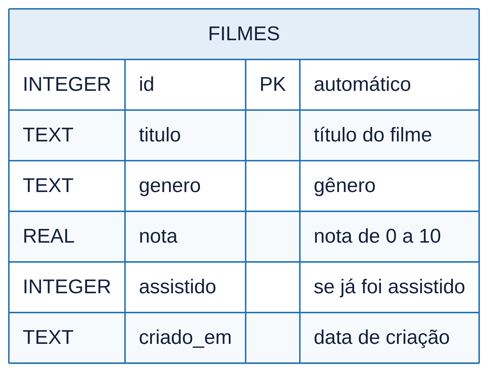

# API de Filmes — FastAPI + SQLite no Azure App Service

Lista de filmes e avaliações com SQLite, hospedada no Azure App Service.

- **URL da API:** https://<nome-do-seu-app>.azurewebsites.net
- **Documentação interativa (Swagger):** https://<nome-do-seu-app>.azurewebsites.net/docs

Aluno: <seu nome> · RM <seu RM>

## Tecnologias

| Camada | Tecnologia |
|---|---|
| Linguagem | Python 3.12 |
| Framework | FastAPI + Pydantic |
| Banco de dados | SQLite (`/home/filmes.db` no Azure) |
| Nuvem | Azure App Service, Linux, plano F1 (Free) |
| Implantação | Azure Cloud Shell + Azure CLI (az webapp up) |

## Arquitetura



## Banco de dados

Tabela `filmes`:

| Campo | Descrição |
|---|---|
| `id` | identificador (automático) |
| `titulo` | título do filme |
| `genero` | gênero |
| `nota` | nota de 0 a 10 |
| `assistido` | se já foi assistido |
| `criado_em` | data de criação (automático) |



## Endpoints

| Método | Rota | Descrição |
|---|---|---|
| GET | `/health` | Verifica se a API está no ar |
| GET | `/filmes` | Lista todos |
| GET | `/filmes/{id}` | Busca um |
| POST | `/filmes` | Cria |
| PUT | `/filmes/{id}` | Atualiza |
| DELETE | `/filmes/{id}` | Remove |

Exemplo de corpo para POST/PUT:

```json
{
  "titulo": "Cidade de Deus",
  "genero": "Drama",
  "nota": 9.5,
  "assistido": true
}
```

## Configuração no Azure

| Item | Valor |
|---|---|
| Startup command | `python -m uvicorn app.main:app --host 0.0.0.0 --port 8000` |
| Variável de ambiente | `DB_PATH=/home/filmes.db` |
| Variável de ambiente | `SCM_DO_BUILD_DURING_DEPLOYMENT=true` |

## Rodar localmente

```bash
python3 -m venv venv
source venv/bin/activate        # no Windows: venv\Scripts\activate
pip install -r requirements.txt
uvicorn app.main:app --reload
```

Abra `http://127.0.0.1:8000/docs`. Testes: `pip install pytest httpx && pytest`
